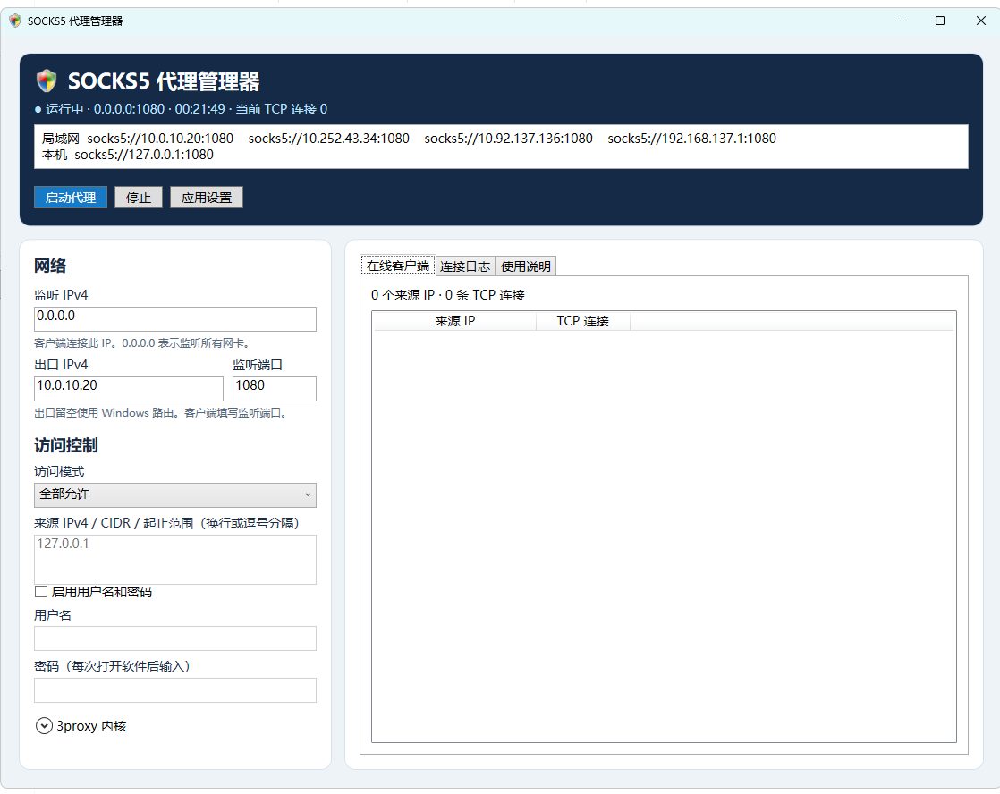

# SOCKS5 代理管理器

双击根目录中的 `Socks5Manager-embedded.exe` 启动。分发给其他电脑时，使用 `Socks5Manager-embedded-win-x64.zip`。

## 目录与构建

Clash / OpenClash 节点及分流规则见 [clash-node.example.yaml](clash-node.example.yaml)。修改其中的 Windows 监听 IP、端口及目标地址，按文件注释合并到运行配置。文件包含可选的账号密码认证示例。

- `Manager.cs` 是界面、代理控制和连接状态读取源码。
- `Build.ps1` 使用 Windows 自带的 .NET Framework C# 编译器构建，默认嵌入 `bin/3proxy.exe`。
- `bin/3proxy.exe` 是构建时使用的代理内核，许可见同目录的 `LICENSE-3proxy.txt`。
- `settings.xml` 在保存设置时生成，存放个人配置，不纳入 Git。

在此目录执行 `powershell.exe -NoProfile -ExecutionPolicy Bypass -File .\Build.ps1` 即可重新生成内嵌 EXE 和便携 ZIP。

在 64 位 Windows 上双击包内的 `Socks5Manager-embedded.exe` 或 `Socks5Manager.exe`。使用 Windows 自带的 .NET Framework 4.x。

1. 内嵌版可直接点击「启动代理」。如果升级时保留了外部内核路径，展开「3proxy 内核」，点击「使用内置」，再启动或应用设置。普通版使用程序旁的 `bin\3proxy.exe`，也可以通过「选择文件」指定外部内核。
2. 仅本机使用可保留默认设置。局域网使用时，把监听地址改为本机 LAN IPv4，再将客户端的来源 IP 或网段加入白名单。客户端代理类型选 SOCKS5，地址填写该 LAN IPv4 和监听端口。
3. 点击「启动」。运行中点击「应用设置」会重启代理并断开已有连接。关闭窗口会隐藏到托盘，托盘菜单的「退出」会停止代理。

白名单仅允许列表中的来源，黑名单仅拒绝列表中的来源。「全部允许」接受所有能访问监听端口的来源。来源列表支持单个 IPv4、CIDR 和起止范围。

「在线客户端」按来源 IP 汇总代理监听端口上已建立的 TCP 连接，包括正在协商的连接。多个设备如果共用一个 NAT 出口，会显示为同一个来源 IP。「连接日志」在会话结束或请求被拒绝时更新。指定出口 IP 会绑定源地址，实际流量仍受 Windows 路由和 VPN 配置影响。

设置保存在 EXE 旁的 `settings.xml`，请解压到有写入权限的目录。首次运行时，如果 EXE 旁还没有设置，程序会读取并复制旧版的 `%LOCALAPPDATA%\Socks5Manager\settings.xml`。密码不写入设置文件，但运行时会写入用户目录下的临时配置，正常停止时删除。局域网访问需要 Windows 防火墙允许相应程序和端口。本版不安装服务、不修改防火墙，也不设置开机启动。

